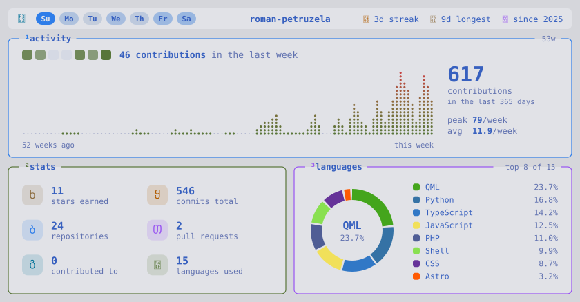

# rpkarticky

GitHub stats card for your profile README, styled like a Linux desktop: a waybar on top and tiled btop boxes below. A GitHub Action generates it once a day and commits it into your profile repo. No server, no shared rate limits.

<picture>
  <source media="(prefers-color-scheme: dark)" srcset="docs/preview-dark.svg">
  
</picture>

What's on it:

- **bar**: contributions per weekday as workspaces (the busiest one is active), current and longest streak, the year you joined
- **activity**: contributions per week over the last year as a dotted graph with total, peak and average, the last 7 days as tiles
- **stats**: stars, commits (all time), repositories, pull requests, repos contributed to, languages used
- **languages**: your top 8 languages by code size

It comes in a dark and a light variant that follows the viewer's GitHub theme. Colors from [Tokyo Night](https://github.com/folke/tokyonight.nvim).

## Add it to your profile

You need your profile repository, the one named after your username (`<username>/<username>`).

**1.** In that repository, create `.github/workflows/stats.yml`:

```yaml
name: stats

on:
  schedule:
    - cron: "0 3 * * *" # every day at 3:00 UTC
  workflow_dispatch:

permissions:
  contents: write # commit the card
  actions: write # keep the daily schedule alive

jobs:
  stats:
    runs-on: ubuntu-latest
    steps:
      - uses: actions/checkout@v5
      - uses: roman-petruzela/rpkarticky@v1
```

**2.** Run it once: **Actions** → **stats** → **Run workflow**. After a few seconds, `stats-dark.svg` and `stats-light.svg` appear in your repository.

**3.** Put the card into your `README.md`:

```html
<picture>
  <source media="(prefers-color-scheme: dark)" srcset="stats-dark.svg">
  
</picture>
```

That's it. The card refreshes every day and is only committed when something changed.

### Include private repositories

By default the action only sees your public repositories. To count private ones too:

1. Create a [classic token](https://github.com/settings/tokens/new) with the `repo` scope.
2. Add it to your profile repository as a secret named `STATS_TOKEN` (**Settings** → **Secrets and variables** → **Actions**).
3. Pass it to the action:

```yaml
      - uses: roman-petruzela/rpkarticky@v1
        with:
          token: ${{ secrets.STATS_TOKEN }}
```

## Options

| Input | Default | Description |
| --- | --- | --- |
| `token` | `github.token` | Token used to read your stats, see [private repositories](#include-private-repositories) |
| `username` | repo owner | Whose stats to show |
| `output-dir` | `.` | Folder the SVGs are written to |
| `commit` | `true` | Commit and push the card when it changes |
| `commit-message` | `chore: update stats cards` | Message of that commit |
| `keepalive` | `true` | Keep the daily schedule running, see below |
| `keepalive-token` | `github.token` | Token used for keepalive |

## FAQ

**The card didn't change after an update.** GitHub caches images for a few minutes. Reload the page with Ctrl+Shift+R.

**Why does it need `actions: write`?** GitHub turns off scheduled workflows in repositories without activity for 60 days. Since the action only commits when your stats change, a quiet profile would lose its schedule. On every run, the action re-enables its own workflow through the API, which resets that timer without any commit. Without the permission the card still works, you'll just see a warning.

**What counts as a commit?** Commits GitHub attributes to you in its contribution graph, summed over every year since you joined. Private ones are included only with a `repo` token and if [private contributions are visible](https://docs.github.com/en/account-and-profile/setting-up-and-managing-your-github-profile/managing-contribution-settings-on-your-profile/showing-your-private-contributions-and-achievements-on-your-profile) on your profile.

## Development

```sh
npm install
npm run dev                      # card for your gh account, open preview/index.html
npm run dev -- torvalds          # any other user
npm run dev -- --cached          # reuse preview/stats.json, no API calls
npm run build                    # bundle into dist/, commit it together with the sources
python3 scripts/build-fonts.py   # regenerate src/fonts.ts (needs fonttools + brotli)
```

Uses `gh auth token` by default, or set `RPK_TOKEN`.

## License

Code under the [MIT License](LICENSE). The cards embed a subset of [JetBrains Mono Nerd Font](https://github.com/ryanoasis/nerd-fonts), licensed under the [SIL Open Font License 1.1](LICENSE-FONT).
